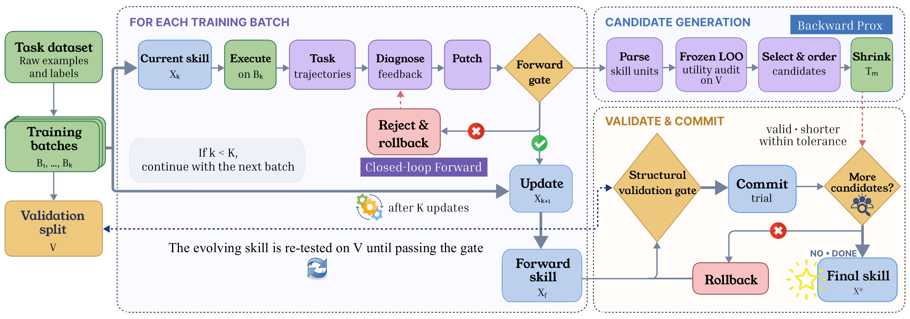

# SkillProx

**Self-evolving agent skills via proximal textual gradient descent.**

SkillProx treats an agent skill package as a structured parameter and
optimizes it with a forward–backward procedure inspired by proximal
gradient descent:

- **Forward (closed-loop evolution).** Each iteration executes the current
  skill on a training batch, diagnoses failures and contrastive successes,
  and patches the skill. Every candidate patch is re-executed on the same
  batch. The first candidate with a strict hard-accuracy gain is kept;
  otherwise up to three candidates are tried and the best by
  (hard accuracy, mean cell accuracy) is kept only if neither metric
  regresses. Rejected attempts and their measured effect are fed back to the
  next diagnosis, and per-iteration accept/reject records form a memory for
  later iterations.
- **Backward (Prox).** After forward training, the skill is decomposed into
  auditable units (L2 sections of `SKILL.md` and L3 reference files). A
  frozen leave-one-out audit on a validation split estimates each unit's
  utility. A Shrinker then consolidates, demotes, or removes low-utility
  units, and each edit is committed only if the skill stays structurally
  valid, gets strictly shorter, and passes a validation gate.

| | |
| --- | --- |
| Paper | [arXiv:2608.07449](https://arxiv.org/abs/2608.07449) |
| Code | <https://github.com/Steven011018/SkillProx> |



## Repository layout

```
pipeline/
  training.py      closed-loop forward evolution (execute → diagnose → momentum → patch → re-check)
  diagnoser.py     failure / contrastive diagnosis with accept/reject feedback
  patcher.py       layer-aware skill patch
  utility.py       frozen leave-one-out utility audit
  shrinkage.py     validation-gated Prox (consolidate / demote / remove)
  skill_parse.py   L2 / L3 unit decomposition of a skill package
prompts/           agent prompts (executor, diagnoser, momentum, patcher, shrinker)
runners/           model dispatch, streaming executor/grader, cost ledger, trajectory logger
evaluators/        xlsx grader used as the terminal loss signal
data/              dataset loader, splits, results layout
scripts/           prepare.sh, base_traj.sh, train.sh, prox.sh, eval.sh
seeds/xlsx/        bundled initial skill (SKILL.md)
assets/            figures referenced from the README
```

## Installation

```bash
pip install -r requirements.txt

cp .env.example .env
# fill in exactly one provider block (OpenAI, Azure OpenAI, self-hosted vLLM, or Gemini)
```

Formula recalculation uses LibreOffice. Point `SE_PIPELINE_REAL_SOFFICE` at
your `soffice` binary if it is not on `PATH`.

## Data

The datasets are not bundled. Download SpreadsheetBench from
<https://spreadsheetbench.github.io/> and place:

- the Verified subset (400 tasks) under `data/benchmarks/spreadsheetbench/`
  — used for training, the utility audit and validation gating;
- the full v0.1 release (912 tasks, three test cases per task) under
  `data/benchmarks/spreadsheetbench_912/` — used only for OJ evaluation.

See [`data/benchmarks/README.md`](data/benchmarks/README.md) for the
expected layout.

## Quickstart

Run from the repo root:

```bash
bash scripts/prepare.sh     # 0. build the 200/200 split and the OJ split
bash scripts/base_traj.sh   # 1. run the seed skill on the evolution pool to collect failures
bash scripts/train.sh       # 2. closed-loop forward evolution
bash scripts/prox.sh        # 3. utility audit + backward Prox
bash scripts/eval.sh        # 4. OJ evaluation on the 100 held-out test tasks
```

Switch the backbone with `MODEL`:

```bash
MODEL=gpt-4.1 bash scripts/train.sh
```

For a self-hosted model, configure the vLLM block in `.env` and pass the
served model name, e.g. `MODEL=qwen-3.6-27b`.

The run id is `skillprox_<MODEL>`. Artifacts land under
`results/runs/skillprox_<MODEL>/`:

```
results/runs/skillprox_gpt-5.4/
├── config.json
├── train/
│   ├── training_results.json      per-iteration attempts, gate decisions, costs
│   ├── diagnoser_prior.jsonl      accept/reject memory fed to later diagnoses
│   ├── iter_<k>/attempt_<j>/      diagnoses, patched_skill/, same-batch recheck/
│   └── final_skill/xlsx/          forward skill X_f
├── utility_audit/
│   └── utility_audit.json         per-unit u_hard / u_cell
├── prox/
│   ├── shrinkage_report.json      per-candidate trial and gate decisions
│   └── skill_prox/xlsx/           final skill X*
└── eval_oj/
    └── summary.json
```

To evaluate the forward skill without Prox:

```bash
SKILL_DIR=results/runs/skillprox_gpt-5.4/train/final_skill \
OUTPUT_DIR=results/runs/skillprox_gpt-5.4/eval_oj_forward \
bash scripts/eval.sh
```

## Configuration

The scripts use the settings reported in the paper.

| Stage | Setting | Flag |
| --- | --- | --- |
| Forward | 40 training tasks, batch size 4 | `--n-train 40 --batch-size 4` |
| Forward | closed loop on, 3 attempts, hard tolerance 0, prior size 6 | `--closed-loop --cl-max-attempts 3 --cl-hard-tol 0 --cl-prior-k 6` |
| Utility audit | 20 validation tasks, \(\epsilon_{\text{cell}} = 0.025\) | `--eps-cell 0.025` |
| Prox | candidate threshold \(\tau = -0.001\) | `--min-neg-utility -0.001` |
| Prox | hard / cell tolerance \(\delta_h = 0\), \(\delta_c = 0.02\) | `--hard-tol 0 --cell-tol 0.02` |
| Prox | soft compression cap \(\rho = 0.10\) | `--max-compression 0.10` |
| OJ eval | 100 tasks, 3 test cases | `--oj --test-cases 3` |

Run `python -m pipeline.training --help`, `python -m pipeline.utility --help`
and `python -m pipeline.shrinkage --help` for the full lists.

## Acknowledgements

We thank Hanyu Wang, Yifan Lan, Bochuan Cao, Lu Lin and Jinghui Chen for
open-sourcing [SkillGrad](https://github.com/wwwhy725/SkillGrad). SkillProx
is built on their codebase, released under the MIT License; their copyright
notice is retained in [`LICENSE`](LICENSE).

## Citation

```bibtex
@misc{zheng2026skillprox,
  title         = {{SkillProx}: Self-Evolving Agent Skills via Proximal Textual Gradient Descent},
  author        = {Mingxuan Zheng and Yujin Zhou and Chuxue Cao and Boqin Yin and Yuyao Zhang and Jiapeng Sun and Shuaishuai Gong and Sirui Han and Yike Guo},
  year          = {2026},
  eprint        = {2608.07449},
  archivePrefix = {arXiv},
  primaryClass  = {cs.AI},
  url           = {https://arxiv.org/abs/2608.07449}
}

@misc{wang2026skillgrad,
  title         = {{SkillGrad}: Optimizing Agent Skills Like Gradient Descent},
  author        = {Hanyu Wang and Yifan Lan and Bochuan Cao and Lu Lin and Jinghui Chen},
  year          = {2026},
  eprint        = {2605.27760},
  archivePrefix = {arXiv},
  primaryClass  = {cs.AI},
  url           = {https://arxiv.org/abs/2605.27760}
}
```
